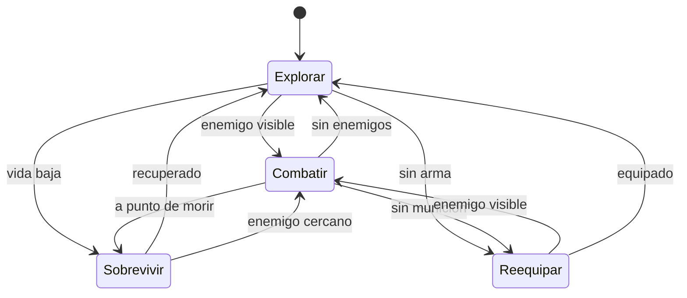

# Inteligencia Artificial para Videojuegos Práctica 3: Disturbios Orbitales

***Autores***
- Haoshuang Hou ([HaoshuangHou](https://github.com/HaoshuangHou))
- Bingcheng Wang ([bingoo30](https://github.com/bingoo30))
- Leopold Popper ([Kang-Hsi](https://github.com/Kang-Hsi))

# Resumen

Un prototipo básico de un un entorno virtual que nos sirve para poner en práctica la **toma de decisiones**. Este es el [enunciado](https://narratech.com/es/inteligencia-artificial-para-videojuegos/decision/disturbios-orbitales/) en la web de Narratech.

El objetivo es utilizar máquina de estados jeárquica, técnica frecuentemente usada en la industria, combinado con búsquedas de caminos mediante mallas de navegación y comportamientos de dirección.

# Instalación y uso

Todo el contenido del proyecto está disponible en este repositorio, utilizamos Unity 6 **(6000.3.12f1).**

En el repositorio se localiza el ejecutable de dicha práctica para poder experimentar los comportamientos.
ENLACE

# Introducción

Este proyecto es una práctica de la asignatura de Inteligencia Artificial para Videojuegos del Grado en Desarrollo de Videojuegos de la UCM. Esta práctica consiste en plantear un escenario virtual 3D que representa una  prisión espacial con las siguientes instancias: 
- **Prisioneros**: son enemigos entre sí, cada uno de ello puede ser controlado por un jugador o una IA. Aparecen de alguno de los puntos de regeneración. Pueden moverse, disparar, apuntar, cambiar de arma, saltar, agacharse, correr y volar.
- **Armas**: recolectables sólo para prisioneros. Existen distintos tipos:
    1. *Pistola (gun)*, el arma por defecto.
    2. *Lanzamisiles (launcher)*, lanza unos discos que explotan.
    3. *Fusil de francotirador (sniper)*, arma de largo alcance.
    4. *Lanzallamas (flamethower)*, interesante aunque no haya mecánicas de transmisión de fuego.
    5. *Rifle (rifle)*, arma más pesada pero más estable.
    6. *Dos pistola (guns)*, a falta de una.
    7. *Escopeta (shot gun)*, causa daño en un radio más ancho.
- **Utensilios**: botequines para recuperar salud o el propulsor para poder «volar» con él.
- **Vigilantes robóticos**: Disparan a los prisioneros y pueden matarlos. 
Distinguimos dos tipos:
    1. Torretas: poderosas pero inmóviles.
    2. Robots flotantes: más déviles pero móviles. 

# Punto de partida

Se parte de un proyecto base proporcionado por el profesor y disponible en el siguiente repositorio: [fps-online](https://github.com/narratech/fps-online)

A continuación, se enumera una serie de informaciones básicas del repositorio original:
- *Human_Prefab* representa al jugador humano y *UCM_Bot* es la IA que hay que programar si se quiere tener un bot contra el que enfrentarse.

### Human_Prefab
- Lo más relevante que puede encontrarse en la raíz del prefab:
* NetworkObject: identidad de red del jugador.
* PlayerInput (Input System): componente de Unity que gestiona dispositivos/mapas de entrada.
* NewMonoBehaviourScript (tu “ClientPlayerMove” real, el hombre es que no está bien puesto): habilita cámara/controles sólo para el propietario, crea el HUD del marcador, etc.
* PlayerRespawner: maneja muerte/respawn en red (RPC al server y respawn al cliente).
* ClientNetworkTransform: sincroniza transform (owner authority en tu setup).
* PlayerHealthSync: sincroniza vida/estado.
* PlayerVotingSync (solo en Human): sistema de votación/acciones especiales.
* PlayerNameTag: nombre/kills/deaths en red.
* ClientNetworkAnimator: Script para hacer animación sincronizada.
* Rigging / IK / Weapon sync: WeaponIKSync, ThirdPersonWeaponSync, RigBuilder, constraints, etc. Son scripts de sincronización (por ejemplo PlayerHealthSync, ThirdPersonWeaponSync, LocalVisibility...).
* UI (CanvasScaler, GraphicRaycaster, TMP): el canvas world-space del nametag y elementos.
* CharacterController: componente nativo de Unity para mover un “personaje tipo cápsula” en el mundo sin usar un Rigidbody. Gestiones colisiones, deslizamiento, movimiento 'cinemático', grounding básico... pero no hace nada más.
* PlayerCharacterController: Script de este proyecto que hace las veces de MENTE del CharacterController, lee la entrada con PlayerInputHandler, y lo convierte en movimiento, rotación, coordina la cámara, la animación, está pendiente de la salud, muerte, apuntado, etc. 

### UCM_Bot
En UCM_Bot encontramos componentes muy parecidos, aunque se ha añadido FSM como ejemplo de dónde podría ir una máquina de estados que tome las decisiones de ese bot, y BotGameplayActions para hacer las veces de gestor de acciones.


## Estructura del proyecto

El repositorio nos proporciona el proyecto organizado de una forma específica en la que destaca la carpeta **FPS** donde contiene todos los assets propios del proyecto. Aquí se encuentran:
- Animaciones
- Arte (fuentes de letra, materiales, modelos, shaders y texturas)
- Audio
- Prefabs
- Escenes
- Scripts
- Tutorials

Dentro de la carpeta *script* se localizan:
- AI
- Editor
- Game
- Gameplay
- MiMultiplayer
- UI

# Planteamiento del problema
Tenemos un proyecto de Unity 3D que está compuesto por varias escenas: menú inicial, victoria, derrota, escena principal, escena secundaria y escena de prisión.

El flujo del juego se ilustra con el siguiente diagrama:
<diagrama>
Intro->prision->?

Desarrollamos un prototipo que nos permitirá:

- **A**. Hay un mundo virtual dividido por la malla de navegación de Unity, con las estancias y todos los elementos descritos anteriormente, distribuidos según una serie de puntos representativos del escenario (waypoints). Hay una cámara principal preparada para seguir al protagonista en primera persona desde el comienzo y otra cámara secundaria para tener una vista general de la escena (mini-mapa).

- **B**. El agente que controlamos aparece en uno de los puntos predefinidos del escenario y puede moverse por el escenario con todas las acciones de movimiento descritas anteriormente.

- **C**. La navegación del agente utiliza la malla de navegación de Unity, siendo su comportamiento por defecto intentar recorrer cuidadosamente toda la prisión buscando armas y atacar a otros prisioneros.

- **D**. Para la decisión del agente se usa el código de una máquina de estados finita jerárquica cargada desde un fichero .cs.

- **E**. En resumen, el agente trata de maximizar la métrica principal del juego: número de enemigos que he eliminado – número de veces que he sido eliminado, aunque también se mostrarán por pantalla otras métricas interesantes como número de armas conseguidas, número de utensilios conseguidos, número de vigilantes robóticos eliminados… todo ello con el contexto de la duración de la partida en segundos y el ratio de fotogramas por segundo.

# Diseño de la solución

## Menú

| Elemento | Tipo | Funcionalidad |
|----------|------|--------------|
|Tamaño|Selector|Seleccionar el tamaño del laberinto|
|Minotauros|Selector|Seleccionar el número de minotauros que se van a colocar en la escena|
|Comenzar|Botón|Crear el laberinto y comenzar la simulación|

## HUD


## Controles
|Input|Función|
|--|--|
|Ratón|Mover Teseo hacia el cursor|
|Clic izquierdo ratón|Correr con mayor velocidad (1.5x)|
|Rueda ratón|Zoom|
|F|Cambiar el FPS de la simulación|
|R|Reiniciar simulación con los presets de este laberinto|
|C|Cambiar de heurística|

# Implementación
Los siguientes scripts han sido desarrollados por el equipo durante la práctica:
 
|Script|Tipo|Definición|
|--|--|--|
|Vigia|*Comportamiento*|Rotar aleatoriamente de forma periódica|
|Patrullero|*Comportamiento*|Caminar hacia delante y cambiar la dirección aleatoriamente en un cruce|
|VisionMinotauro|*Componente auxiliar*|Cono de visión de cada enemigo, sirve para comprobar si Teseo es visto|
|IAMinotauro| *Controlador IA* | Controlador de la IA del Minotauro. Gestiona el cambio entre el estado habitual y perseguir a Teseo. |

## **Comportamientos implementados**
### Máquina de estados finitos (FSM)
- Modelo computacional que representa un sistema con un número limitado de estados y que solo puede estar en uno a la vez. 
- Cambia de estado según las entradas actuales y las reglas de transición.
- Características:
    1. Posee un conjunto limitado y definido de modos de operación.
    2. El cambio de un estado a otro se basa en eventos o condiciones.
    3. Solo opera en un estado específico en cada momento.
    4. Puede producir lógicas en las transiciones de salida y/o entrada.
    5. Solo tiene información de su estado presente, no el historial completo.
    6. Las transiciones pueden ser predecibles o tener opciones.
- Pseudocódigos:
**1. Estados y transiciones codificados**
```py
class MyFSM:
    # names for each state 
    enum State:
        PATROL
        ATTACK
        FLEE
    # the current state
    myState: State

    function update():
        # find the correct state
        if myState == PATROL:
            # example transitions
            if cond_A():
                myState = ATTACK
            else if cond_B():
                myState = FLEE
        else if myState == ATTACK:
            # example transitions
            if not cond_A():
                myState = PATROL
        else if myState == FLEE:
            # example transitions
            if not cond_B():
                myState = PATROL
``` 
>```mermaid
>stateDiagram-v2
>
>[*] --> PATROL
>
>PATROL --> ATTACK: cond_A()
>PATROL --> FLEE: cond_B()
>
>ATTACK --> PATROL: not cond_A()
>
>FLEE --> PATROL: not cond_B()
>```
>*Representación gráfica del ejemplo*

**2. Máquina de estados**
```py
class StateMachine:
    # we are in one state at a time
    initialState: State
    # the current state
    currentState: State = initialState

    # check and apply transitions, returning a list of actions:
    function update() -> Actions[]:
        # assume no transition is triggered
        triggered: Transition = null

        # check through each transition and store the first one that triggeres
        for t in currentState.getTransitions():
            if t.isTriggered():
                triggered = t
                break
        
        # check if we have transition to fire
        if triggered:
            # find the target state
            targetState = triggered.getTargetState()

            # add the exit action of the old state, 
            # the transition action and the entry for the new state
            actions = currentState.getExitActions()
            actions += triggered.getActions()
            actions += targetState.getEntryActions()

            # complete the transition and return the action list
            currentState = targetState
            return actions
        # otherwise just return the current state's actions
        else:
            return currentState.getActions()
``` 
**3. Interfaces**
```py
class State:
    funtion getActions() -> Action[]
    funtion getEntryActions() -> Action[]
    funtion getExitActions() -> Action[]
    funtion getTransitions() -> Transition[]

class Transtition:
    # logic condition
    condition: Condition
    funtion isTriggered() -> bool:
        return condition.test()

    targetState: State
    funtion getTargetState() -> State:
        return targetState
    
    actions: Actions[]
    funtion getActions() -> Action[]:
        return actions

# base interface for all FSM conditions
class Condition:
    funtion test() -> bool

# all programmed conditions must inherit from this interface
class MyCondition extends Condition:
    # store datas we want to test

    function test() -> bool:
        # our logic
``` 

### Máquina de estados jerárquica (HFSM)
- Extensión de la FSM que permite que un estado contenga otros sub-estados internos, organizando el comportamiento en niveles y evitando la repetición de lógica común.
- Características:
    1. Un estado puede tener dentro otros estados.
    2. Los estados hijos heredan las transiciones y acciones del estado padre.
    3. Evita dibujar la misma transición desde muchos estados.
    4. Al entrar a un padre, se puede activar su estado hijo inicial.
    5. Puede recordar en qué sub-estado estaba al salir y volver allí al reingresar.
    6. Lo que aplica para varios estados se declara una sola vez en el ancestro común.
    7. Permite crecer el comportamiento sin explotar en transiciones cruzadas.
- Pseudocódigos:
**1. Interfaz base**
```py
class HSMBase:
    # the structure returned by update
    class UpdateResult:
        actions
        transition
        level
    
    function getActions() -> Action[]:
        return []
    
    function update() -> UpdateResult:
        UpdateResult result = new UpdateResult()
        result.actions = getActions()
        result.transition = null
        result.level = 0
        return result
    
    # pure virtual function
    function getStates() -> State[] 
``` 
**2. Máquina de estados jerárquica**
```py
class HierarchicalStateMachine extends HSMBase:
    # list of states for when the machine has no current state
    initialState: State

    # current state of the machine
    currentState: State = initialState

    # get the current state stack
    function getStates() -> State[]:
        if currentState:
            return currentState.getStates()
        else:
            return []
    
    # recursively update the machine
    function update() -> UpdateResult:
        # if we're in no state, just use the initial one
        if not currentState:
            currentState = initialState
            return currentState.getEntryActions()
        
        # try to find a transition in the current state
        triggeredTransition = null
        for t in currentState.getTransitions():
            if t.isTriggered():
                triggeredTransition = t
                break
        
        # if we found one, make a result structure of it
        if triggeredTransition:
            result = new UpdateResult()
            result.actions = []
            result.transition = triggeredTransition
            result.level = triggeredTransition.getLevel()
        # otherwise, recurse down for a result
        else:
            result = currentState.update()
        
        # check if the result contains a transition
        if result.transition:
            # act based on its level
            if result.level == 0:
                # its on our level: honor it
                targetState = result.transition.getTargetState()
                result.actions += result.transition.getTargetState()
                result.actions += currentState.getExitActions()
                result.actions += result.transition.getActions()
                result.actions += targetState.getEntryActions()

                # set our current state
                currentState = targetState

                # add our normal action (we may be a state)
                result.actions += getActions()

                # clear the transition 
                result.transition = null
            else if result.levels > 0:
                # it's destinated for a higher level
                # exit our current state
                result.actions += currentState.getExitActions()
                currentState = null

                # decrease the number of levels to go
                result.level -= 1
            else:
                # it needs to be passed down
                targetState = result.transition.getTargetState()
                targetMachine = targetState.parent
                result.actions += result.transition.getActions()
                result.actions += targetMachine.updateDown(targetState, -result.level)

                # clear the transition, so nobody elsee does it
                result.transition = null
        # if we did not get a transition
        else:
            # just do normal action
            result.action += getActions()
        
        return result
    
    # recurses up the parent hierarchy, transitioning into each state 
    # in turn for the given number of levels
    function updateDown(state: State, level: int) -> Action[]:
        # if we are not top level, continue
        if level > 0:
            # pass ourself as transition state to our parent
            actions = parent.updateDown(this, level-1)
        # otherwise we have no actions to add
        else:
            actions = []
        
        # if we have a current state, exit it
        if currentState:
            actions += currentState.getExitActions()

        # move to the new state, and return all the actions
        currentState = state
        actions += state.getEntryActions()

        return actions 
``` 
**3. Estado y Transición**
```py
class State: extends HSMBase:
    function getStates() -> State:
        # if we are just a state, then the stack is just us
        return [this]
    
    funtion getActions() -> Action[]
    funtion getEntryActions() -> Action[]
    funtion getExitActions() -> Action[]
    funtion getTransitions() -> Transition[]

class Transtition:
    # return the difference in levels of the hierarchy from 
    # the source to the target of the transition
    function getLevel() -> int

    funtion isTriggered() -> bool
    funtion getTargetState() -> State
    funtion getActions() -> Action[]
``` 
**4. Submáquina de estados**
```py
class SubMachineState: extends State, HierarchicalStateMachine:
    # route to the state
    funcion getActions() -> Action[]:
        return State.getActions()
    
    # route update to the state machine
    function update() -> Action[]:
        return HierarchicalStateMachine.update()
    
    # we get states by adding ourself to our active children
    function getStates() -> State[]:
        if currentState:
            return [this] + currentState.getStates()
        else:
            return [this]
``` 
## Implementación de cada apartado

### Apartado A


### Apartado B

### Apartado C

### Apartado D
El comportamiento del agente inteligente se ha implementado mediante una **máquina de estados finita jerárquica (HFSM)**, cuyo objetivo es gestionar de forma estructurada y eficiente la toma de decisiones dentro del entorno dinámico.

#### D.1. Enfoque general

Se ha optado por un diseño jerárquico en lugar de una máquina de estados plana, con el fin de mejorar la modularidad, escalabilidad y mantenibilidad del sistema. Este enfoque permite separar:

- *Decisiones estratégicas (alto nivel):* determinan el objetivo global del agente.
- *Decisiones tácticas (bajo nivel):* definen cómo se ejecuta dicho objetivo en función del contexto actual.

La arquitectura se compone de una **máquina de estados principal (global)** y varias **submáquinas especializadas**, cada una encargada de gestionar un comportamiento concreto.


#### D.2. Máquina de estados global

La máquina de estados global actúa como el núcleo del sistema de decisión y determina el estado general del agente en cada instante. Los estados principales definidos son:

* **Explorar:** comportamiento por defecto. El agente recorre el entorno utilizando la malla de navegación de Unity y waypoints, explorando distintas estancias y buscando recursos o enemigos.
* **Combatir:** se activa cuando el agente detecta enemigos. En este estado se gestionan todas las acciones de ataque.
* **Sobrevivir:** prioriza la supervivencia del agente cuando su salud es baja.
* **Reequipar:** se encarga de la búsqueda y adquisición de armas o botequín cuando el agente no dispone de recursos adecuados.

Las transiciones entre estos estados se basan en condiciones del entorno y del propio agente, tales como la visibilidad de enemigos, la candidad de vida o la disponibilidad de munición.

---

#### D.3. Submáquinas de estados

Cada estado principal contiene una submáquina de estados que gestiona el comportamiento detallado del agente.

- **3.1. Submáquina de Combate**

    Es la más compleja del sistema y controla las interacciones directas con otros agentes. Incluye los siguientes estados:

    - **Decidir:** evalúa la situación inicial y decide la acción más adecuada.
    - **Perseguir:** el agente persigue al enemigo cuando no está en rango de ataque.
    - **Atacar:** ejecución de acciones ofensivas como apuntar, disparar y moverse lateralmente.
    - **Cubrir:** búsqueda de cobertura cuando el agente se encuentra en desventaja.
    - **Retirar:** retirada estratégica en situaciones críticas.
    ```mermaid
    stateDiagram-v2
    [*] --> Decidir

    Decidir --> Atacar : en rango
    Decidir --> Perseguir : lejos
    Decidir --> Cubrir : desventaja
    Decidir --> Retirar : vida baja

    Perseguir --> Atacar : visible
    Perseguir --> Decidir : pierde objetivo

    Atacar --> Cubrir : mucho daño
    Atacar --> Perseguir : pierde visión
    Atacar --> Retirar : vida baja

    Cubrir --> Atacar : ventaja
    Cubrir --> Retirar : presión

    Retirar --> Decidir : recuperado
    ```
---

- **3.2. Submáquina de Supervivencia**
    Gestiona el comportamiento defensivo del agente:
    - **Evadir:** evasión para evitar daño.
    - **BuscarBotequín:** buscar de botiquines en el entorno.
    - **Esconder:** permanecer en zonas seguras hasta recuperar condiciones favorables.
    ```mermaid
    stateDiagram-v2
    [*] --> Evadir

    Evadir --> BuscarBotequín : detecta botiquín
    BuscarBotequín --> Esconder : recuperando
    Esconder --> Evadir : peligro

    Esconder --> [*] : recuperado
    ```
---

- **3.3. Submáquina de Reequipamiento**
    Encargada de optimizar el equipamiento del agente en función de la situación del entorno, mejorando tanto su capacidad ofensiva como su supervivencia y movilidad:

    - **BuscarArma:** localización y recogida de armas disponibles en el entorno.
    - EvaluateWeapon: análisis del arma actual en comparación con otras disponibles, teniendo en cuenta factores como distancia al enemigo o tipo de combate.
    - **ElegirArma:** selección y cambio al arma más adecuada según la situación.
    - **BuscarUtilidad:** búsqueda de utensilios como botiquines o el jetpack, que permiten mejorar la supervivencia o movilidad del agente.
    - **UsarPropulsor:** activación y uso del jetpack en situaciones donde proporciona ventaja táctica.

    El uso del jetpack introduce una mejora significativa en la movilidad del agente, permitiéndole acceder a zonas elevadas, escapar de situaciones de peligro o reposicionarse estratégicamente durante el combate.

    ```Mermaid
    stateDiagram-v2
    [*] --> BuscarArma

    BuscarArma --> ElegirArma
    ElegirArma --> BuscarUtilidad

    BuscarUtilidad --> [*] : equipado

    [*] --> UsarPropulsor : necesita ventaja
    UsarPropulsor --> [*]
    ```
---

- **3.4. Submáquina de Exploración**

    Controla el desplazamiento por el entorno:

    - **Patrullar:** recorrido de puntos clave del mapa.
    - **BuscarRecursos:** búsqueda de recursos cercanos.
    - **Investigar:** inspección de eventos relevantes como sonidos o combates cercanos.
    ```mermaid
    stateDiagram-v2
    [*] --> Patrullar

    Patrullar --> BuscarRecursos : recurso detectado
    Patrullar --> Investigar : evento detectado

    BuscarRecursos --> Patrullar : sin recursos cercanos
    BuscarRecursos --> Investigar : evento cercano

    Investigar --> Patrullar : sin evento
    Investigar --> BuscarRecursos : recurso detectado
    ```
---

#### D.4. Integración con el sistema

La máquina de estados no actúa de forma aislada, sino que se integra con otros subsistemas del agente:

- **Navegación (NavMesh):** utilizada para el movimiento entre posiciones.
- Proporciona información sobre enemigos, objetos y eventos del entorno.
- Almacena variables compartidas como salud, munición o posiciones de interés.
Cada actualización del agente consiste en evaluar el estado actual, comprobar las condiciones de transición y ejecutar la lógica asociada al estado activo.

---

#### D.5. Ventajas del enfoque

El uso de una máquina de estados jerárquica aporta múltiples beneficios:

- **Modularidad:** cada comportamiento se implementa de forma independiente.
- **Escalabilidad:** permite añadir nuevos estados sin modificar la estructura global.
- **Reutilización:** las submáquinas pueden emplearse en otros agentes.
- **Claridad:** facilita la comprensión y depuración del sistema.

---

### Apartado E

## Evolución
|**Estado**|**Tarea**|**Fecha**|
|--|--|--|
|✔|Preparación: Primer contacto y creación del repositorio|9-4-2026|
## Pruebas y métricas

A continuación se detalla un plan de pruebas para verificar que se cumplen todos los requisitos del enunciado. Se organiza por apartados (A–E) según las características.

- **Apartado A**

    ---
- **Apartado B**

    ---
- **Apartado C**
    
    ---
- **Apartado D**
    
    ---
- **Apartado E**

        
## Conclusiones

### Vídeo explicativo
[Vídeo de demostración en YouTube](https://youtu.be/n7ElxGUhQ7Y)
    
## Licencia
- Uso educativo y de investigación - UCM
- Copyright (c) 2026 Haoshuang Hou, Bingcheng Wang, Leopold Popper
- Se concede permiso permanente a los profesores de la Facultad de Informática de la Universidad Complutense de Madrid para utilizar, reproducir, modificar o distribuir total o parcialmente este material (documentación, código y recursos), con fines educativos o de investigación. Se permite obtener datos agregados de forma anónima o utilizar el material con reconocimiento expreso de los autores.
- Esta licencia no otorga derechos de uso comercial fuera del ámbito educativo o de investigación, salvo autorización expresa de los autores.


## Referencias

### Bibliografía
* Millington, I. (2019). *AI for Games* (3.ª ed.). CRC Press. 
* de Byl, P.: Finite State Machines (URL)
poner mas
### Recursos y assets
* Unity: Introduction to Visual Scripting (URL)
* Unity: Script Machines and State Machines (URL)
### Videojuegos referentes
Poner algun juego
