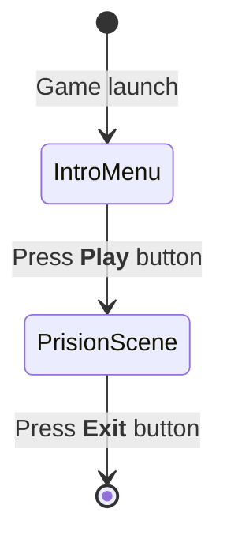
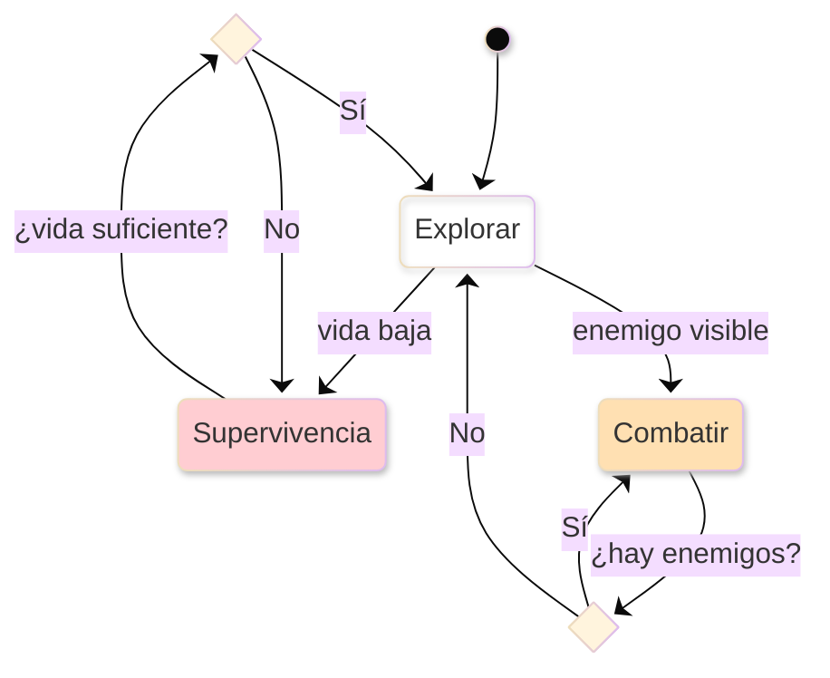

# CAMBIOS: PRÁCTICAMENTE TODO EL README
# Inteligencia Artificial para Videojuegos Práctica 3: Disturbios Orbitales

***Autores***
- Haoshuang Hou ([HaoshuangHou](https://github.com/HaoshuangHou))
- Bingcheng Wang ([bingoo30](https://github.com/bingoo30))
- Leopold Popper ([Kang-Hsi](https://github.com/Kang-Hsi))

# Resumen

Un prototipo básico de un un entorno virtual que nos sirve para poner en práctica la **toma de decisiones**. Este es el [enunciado](https://narratech.com/es/inteligencia-artificial-para-videojuegos/decision/disturbios-orbitales/) en la web de Narratech.

El objetivo es usar una máquina de estados jeárquica, técnica frecuentemente usada en la industria, combinado con búsquedas de caminos mediante mallas de navegación y comportamientos de dirección.

# Instalación y uso

Todo el contenido del proyecto está disponible en este repositorio. Se utiliza Unity 6 **(6000.3.12f1).**

En el repositorio se localiza el ejecutable de dicha práctica para poder experimentar los comportamientos.
ENLACE

# Introducción

Este proyecto es una práctica de la asignatura de Inteligencia Artificial para Videojuegos del Grado en Desarrollo de Videojuegos de la UCM. Consiste en plantear un escenario virtual 3D que representa una prisión espacial con las siguientes instancias: 
- **Prisioneros**: son enemigos entre sí. Cada uno de ellos puede ser controlado por un jugador o una IA. Aparecen en alguno de los puntos de regeneración establecidos. Pueden moverse, disparar, apuntar, cambiar de arma, saltar, agacharse, correr y volar.
- **Armas**: objectos recolectables exclusivamente para los prisioneros. Existen distintos tipos:
    1. *Pistola (gun)*: arma por defecto.
    2. *Lanzamisiles (launcher)*: arma que lanza unos discos explosivos.
    3. *Fusil de francotirador (sniper)*: arma de largo alcance.
    4. *Lanzallamas (flamethower)*: arma que lanza llamas,pero no hay mecánicas de propagación del fuego. .
    5. *Rifle (rifle)*: arma de mayor estabilidad, aunque también de mayor peso.
    6. *Dos pistola (guns)*.
    7. *Escopeta (shot gun)*: arma que produce daño en un radio más ancho.
- **Utensilios**: botiquines para recuperar salud o el propulsor para poder «volar» con él.
- **Vigilantes robóticos**: disparan a los prisioneros y pueden matarlos. 
Distinguimos dos tipos:
    1. Torretas: poderosas pero inmóviles.
    2. Robots flotantes: más déviles pero móviles. 

# Punto de partida

Se parte de un proyecto base proporcionado por el profesor y disponible en el siguiente repositorio: [fps-online](https://github.com/narratech/fps-online)

A continuación, se enumera una serie de informaciones básicas del repositorio original:
- *Human_Prefab* representa al jugador humano.
- *UCM_Bot* es la IA que hay que programar si se quiere un bot contra el que enfrentarse.

### Human_Prefab
- Lo más relevante que puede encontrarse en la raíz del prefab:
* *NetworkObject:* identidad de red del jugador.
* *PlayerInput (Input System):* componente de Unity que gestiona dispositivos/mapas de entrada.
* *NewMonoBehaviourScript:* habilita cámara/controles sólo para el propietario, crea el HUD del marcador, etc.
* *PlayerRespawner:* maneja muerte/respawn en red (RPC al server y respawn al cliente).
* *ClientNetworkTransform:* sincroniza transform (owner authority en tu setup).
* *PlayerHealthSync:* sincroniza vida/estado.
* *PlayerVotingSync (solo en Human):* sistema de votación/acciones especiales.
* *PlayerNameTag:* nombre/kills/deaths en red.
* *ClientNetworkAnimator:* Script para hacer animación sincronizada.
* *Rigging / IK / Weapon sync:* WeaponIKSync, ThirdPersonWeaponSync, RigBuilder, constraints, etc. Son scripts de sincronización (por ejemplo PlayerHealthSync, ThirdPersonWeaponSync, LocalVisibility...).
* *UI (CanvasScaler, GraphicRaycaster, TMP):* el canvas world-space del nametag y elementos.
* *CharacterController: componente nativo de Unity para mover un “personaje tipo cápsula” en el mundo sin usar un Rigidbody. Gestiones colisiones, deslizamiento, movimiento 'cinemático', grounding básico... pero no hace nada más.
* *PlayerCharacterController:* Script de este proyecto que hace las veces de MENTE del CharacterController, lee la entrada con PlayerInputHandler, y lo convierte en movimiento, rotación, coordina la cámara, la animación, está pendiente de la salud, muerte, apuntado, etc. 

### UCM_Bot
En UCM_Bot encontramos componentes muy parecidos, aunque se ha añadido FSM como ejemplo de dónde podría ir una máquina de estados que tome las decisiones de ese bot, y BotGameplayActions para hacer las veces de gestor de acciones.


## Estructura del proyecto

El repositorio nos proporciona el proyecto organizado de una forma específica en la que destaca la carpeta **FPS**, que contiene todos los assets propios del proyecto:
- Animaciones
- Arte (fuentes de letra, materiales, modelos, shaders y texturas)
- Audio
- Prefabs
- Escenes
- Scripts
- Tutorials

Dentro de la carpeta *script* se localizan las siguientes carpetas:
- AI
- Editor
- Game
- Gameplay
- MiMultiplayer
- UI

# Planteamiento del problema
Partimos de un proyecto de Unity 3D compuesto por varias escenas: menú inicial, victoria, derrota, escena principal, escena secundaria y escena de prisión.
El juego seria infinito, es decir, que se puede revivir cada vez que se muera. El flujo del juego se ilustra con el siguiente diagrama:


Desarrollamos un prototipo que nos permitirá:

- **A**.Mundo virtual dividido por la malla de navegación de Unity, con las estancias y todos los elementos distribuidos según una serie de puntos representativos del escenario. Dispone de una cámara en primera persona y otra cámara para tener una vista general de la escena.

- **B**. El agente que controlamos aparece en uno de los puntos predefinidos del escenario y puede realizar todas las acciones de movimiento descritas anteriormente.

- **C**. La navegación del agente utiliza la malla de navegación de Unity, siendo su comportamiento por defecto intentar recorrer la prisión buscando armas y atacar a otros prisioneros.

- **D**. La decisión del agente se usa el código de una máquina de estados finita jerárquica cargada desde un fichero .cs.

- **E**. El agente busca maximizar la métrica principal del juego: *número de enemigos eliminado – número de veces que he sido eliminado*. También se muestran por pantalla otras métricas interesantes como número de armas conseguidas, número de utensilios conseguidos, número de vigilantes robóticos eliminados… todo ello con el contexto de la duración de la partida en segundos y el ratio de fotogramas por segundo.

# Diseño de la solución

## Controles del juego
|Input|Función|
|--|--|
| Ratón | Rotación de la cámara. |
| Clic izquierdo del ratón | Atacar con el arma actualmente equipada. |
| Clic derecho del ratón | Activar el zoom para apuntar con el arma equipada en ese momento. |
| Rueda del ratón / Teclas de número / E / Q | Cambiar de arma. |
| Tab / P | Activar o desactivar el menú de opciones / pausa. |
| WASD/ Flechas| Movimiento del personaje. |
| C | Agachar. |
| Barra espaciadora (Space) | Saltar/ Jetpack. |
| Shift| Correr a mayor velocidad. |

# Implementación
Los siguientes scripts han sido desarrollados por el equipo durante la práctica:
 
|Script|Tipo|Definición|
|--|--|--|
|CameraFollow|Component|Controla el seguimiento de la camara segundaria al jugador para la minimapa|
|Waypoints ||

## **Comportamientos**
### Máquina de estados finitos (FSM)
- Modelo computacional que representa un sistema con un número limitado de estados y que solo puede estar en uno a la vez. 
- Cambia de estado según las entradas actuales y las reglas de transición.
- Características:
    1. Posee un conjunto limitado y definido de modos de operación.
    2. El cambio de un estado a otro se basa en eventos o condiciones.
    3. Solo opera en un estado específico en cada momento.
    4. Puede producir lógicas en las transiciones de salida y/o entrada.
    5. Solo tiene información de su estado presente, no el historial completo.
    6. Las transiciones pueden ser predecibles o tener opciones.
- Pseudocódigos:
**1. Estados y transiciones codificados**
```py
class MyFSM:
    # names for each state 
    enum State:
        PATROL
        ATTACK
        FLEE
    # the current state
    myState: State

    function update():
        # find the correct state
        if myState == PATROL:
            # example transitions
            if cond_A():
                myState = ATTACK
            else if cond_B():
                myState = FLEE
        else if myState == ATTACK:
            # example transitions
            if not cond_A():
                myState = PATROL
        else if myState == FLEE:
            # example transitions
            if not cond_B():
                myState = PATROL
``` 
>```mermaid
>stateDiagram-v2
>
>[*] --> PATROL
>
>PATROL --> ATTACK: cond_A()
>PATROL --> FLEE: cond_B()
>
>ATTACK --> PATROL: not cond_A()
>
>FLEE --> PATROL: not cond_B()
>```
>*Representación gráfica del ejemplo*

**2. Máquina de estados**
```py
class StateMachine:
    # we are in one state at a time
    initialState: State
    # the current state
    currentState: State = initialState

    # check and apply transitions, returning a list of actions:
    function update() -> Actions[]:
        # assume no transition is triggered
        triggered: Transition = null

        # check through each transition and store the first one that triggeres
        for t in currentState.getTransitions():
            if t.isTriggered():
                triggered = t
                break
        
        # check if we have transition to fire
        if triggered:
            # find the target state
            targetState = triggered.getTargetState()

            # add the exit action of the old state, 
            # the transition action and the entry for the new state
            actions = currentState.getExitActions()
            actions += triggered.getActions()
            actions += targetState.getEntryActions()

            # complete the transition and return the action list
            currentState = targetState
            return actions
        # otherwise just return the current state's actions
        else:
            return currentState.getActions()
``` 
**3. Interfaces**
```py
class State:
    funtion getActions() -> Action[]
    funtion getEntryActions() -> Action[]
    funtion getExitActions() -> Action[]
    funtion getTransitions() -> Transition[]

class Transtition:
    # logic condition
    condition: Condition
    funtion isTriggered() -> bool:
        return condition.test()

    targetState: State
    funtion getTargetState() -> State:
        return targetState
    
    actions: Actions[]
    funtion getActions() -> Action[]:
        return actions

# base interface for all FSM conditions
class Condition:
    funtion test() -> bool

# all programmed conditions must inherit from this interface
class MyCondition extends Condition:
    # store datas we want to test

    function test() -> bool:
    # our logic
``` 

### Máquina de estados jerárquica (HFSM)
- Extensión de la FSM que permite que un estado contenga otros sub-estados internos, organizando el comportamiento en niveles y evitando la repetición de lógica común.
- Características:
    1. Un estado puede tener dentro otros estados.
    2. Los estados hijos heredan las transiciones y acciones del estado padre.
    3. Evita dibujar la misma transición desde muchos estados.
    4. Al entrar a un padre, se puede activar su estado hijo inicial.
    5. Puede recordar en qué sub-estado estaba al salir y volver allí al reingresar.
    6. Lo que aplica para varios estados se declara una sola vez en el ancestro común.
    7. Permite crecer el comportamiento sin explotar en transiciones cruzadas.
- Pseudocódigos:
**1. Interfaz base**
```py
class HSMBase:
    # the structure returned by update
    class UpdateResult:
        actions
        transition
        level
    
    function getActions() -> Action[]:
        return []
    
    function update() -> UpdateResult:
        UpdateResult result = new UpdateResult()
        result.actions = getActions()
        result.transition = null
        result.level = 0
        return result
    
    # pure virtual function
    function getStates() -> State[] 
``` 
**2. Máquina de estados jerárquica**
```py
class HierarchicalStateMachine extends HSMBase:
    # list of states for when the machine has no current state
    initialState: State

    # current state of the machine
    currentState: State = initialState

    # get the current state stack
    function getStates() -> State[]:
        if currentState:
            return currentState.getStates()
        else:
            return []
    
    # recursively update the machine
    function update() -> UpdateResult:
        # if we're in no state, just use the initial one
        if not currentState:
            currentState = initialState
            return currentState.getEntryActions()
        
        # try to find a transition in the current state
        triggeredTransition = null
        for t in currentState.getTransitions():
            if t.isTriggered():
                triggeredTransition = t
                break
        
        # if we found one, make a result structure of it
        if triggeredTransition:
            result = new UpdateResult()
            result.actions = []
            result.transition = triggeredTransition
            result.level = triggeredTransition.getLevel()
        # otherwise, recurse down for a result
        else:
            result = currentState.update()
        
        # check if the result contains a transition
        if result.transition:
            # act based on its level
            if result.level == 0:
                # its on our level: honor it
                targetState = result.transition.getTargetState()
                result.actions += result.transition.getTargetState()
                result.actions += currentState.getExitActions()
                result.actions += result.transition.getActions()
                result.actions += targetState.getEntryActions()

                # set our current state
                currentState = targetState

                # add our normal action (we may be a state)
                result.actions += getActions()

                # clear the transition 
                result.transition = null
            else if result.levels > 0:
                # it's destinated for a higher level
                # exit our current state
                result.actions += currentState.getExitActions()
                currentState = null

                # decrease the number of levels to go
                result.level -= 1
            else:
                # it needs to be passed down
                targetState = result.transition.getTargetState()
                targetMachine = targetState.parent
                result.actions += result.transition.getActions()
                result.actions += targetMachine.updateDown(targetState, -result.level)

                # clear the transition, so nobody elsee does it
                result.transition = null
        # if we did not get a transition
        else:
            # just do normal action
            result.action += getActions()
        
        return result
    
    # recurses up the parent hierarchy, transitioning into each state 
    # in turn for the given number of levels
    function updateDown(state: State, level: int) -> Action[]:
        # if we are not top level, continue
        if level > 0:
            # pass ourself as transition state to our parent
            actions = parent.updateDown(this, level-1)
        # otherwise we have no actions to add
        else:
            actions = []
        
        # if we have a current state, exit it
        if currentState:
            actions += currentState.getExitActions()

        # move to the new state, and return all the actions
        currentState = state
        actions += state.getEntryActions()

        return actions 
``` 
**3. Estado y Transición**
```py
class State: extends HSMBase:
    function getStates() -> State:
        # if we are just a state, then the stack is just us
        return [this]
    
    funtion getActions() -> Action[]
    funtion getEntryActions() -> Action[]
    funtion getExitActions() -> Action[]
    funtion getTransitions() -> Transition[]

class Transtition:
    # return the difference in levels of the hierarchy from 
    # the source to the target of the transition
    function getLevel() -> int

    funtion isTriggered() -> bool
    funtion getTargetState() -> State
    funtion getActions() -> Action[]
``` 
**4. Submáquina de estados**
```py
class SubMachineState: extends State, HierarchicalStateMachine:
    # route to the state
    funcion getActions() -> Action[]:
        return State.getActions()
    
    # route update to the state machine
    function update() -> Action[]:
        return HierarchicalStateMachine.update()
    
    # we get states by adding ourself to our active children
    function getStates() -> State[]:
        if currentState:
            return [this] + currentState.getStates()
        else:
            return [this]
```
**5. Cargador de estados**
```py

public class HFSMLoader : MonoBehaviour
    Dictionary<StateSO, State> states = new Dictionary<StateSO, State>();

    public static HFSMLoader Instance { 
        get; 
        private set; 
    }

    void Awake()
    {
        if (Instance == null)
        {
            Instance = this;
            DontDestroyOnLoad(gameObject);
        }
        else
        {
            Destroy(gameObject);
        }
    }
    public State GetState(StateSO so)
    {
        add(so);
        return states[so];
    }
    private void add(StateSO s)
    {
        if (!states.ContainsKey(s))
        {
            states[s] = null;
            State state = new State(s);
            states[s] = state;
        }
    }
}

class HFSMLoader: (singleton)
    # dictionary (key: StateSO; value: State)
    states: Dict[]
    
    # we get states by adding ourself to our active children
    function getState(so) -> State:
        # if this data is not added in the dictionary, create a State and add it
        add(so)
        return states[so]

    function add(so):
         if !states.ContainsKey(s)):
            states[s] = null
            state = new State(s)
            states[s] = state
``` 
## Implementación de cada apartado
### Apartado A
- La malla de navegación del escenario se encuentra previamente integrada en la base del proyecto, permitiendo la delimitación y navegación entre las distintas estancias del entorno virtual.

- Se ha implementado un manager mediante un patrón Singleton (`WaypointsManager`), encargado de almacenar y administrar los diferentes waypoints del escenario. Entre estos se incluyen los puntos de aparición de armas, botiquines, enemigos y sus respectivos puntos de respawn.

- El proyecto dispone de una cámara en primera persona proporcionada en la base inicial. Adicionalmente, se ha desarrollado una segunda cámara ortogonal con vista cenital, vinculada al seguimiento del bot, utilizada como sistema de minimapa para ofrecer una visión general del entorno.


### Apartado B
- El sistema de respawn se encuentra implementado en la base del proyecto. La escena dispone de distintos puntos de reaparición distribuidos, de manera que, cuando el bot es eliminado, selecciona uno de ellos como nueva posición de aparición. Sólo que en vez de obtener esos puntos por una búsqueda por tag, sea que `WaypointsManager` te devuelva la lista de waypoints.

- En el script `BotGameplayActions.cs` se implementan las principales acciones de comportamiento del bot, incluyendo el desplazamiento hacia objetivos mediante el sistema `NavMeshAgent` de Unity, el disparo, el cambio de arma y otras mecánicas relacionadas con la jugabilidad y la interacción dentro del entorno.

### Apartado C
- Se ha creado un componente nuevo (`BotController`) para prototipar y verificar la navegación por `NavmeshAgent`, que usa métodos estáticos para buscar waypoint (uno aleatorio, un arma, una cura) y intentar llegar a ese punto usando métodos proporcionados por `BotGameplayActions`.

### Apartado D
- El comportamiento del agente inteligente se ha implementado mediante una **Máquina de Estados Finitos Jerárquica (HFSM)**, cuyo objetivo es gestionar de forma estructurada, modular y eficiente la toma de decisiones dentro de un entorno dinámico.

- Para ello, se han desarrollado todos los scripts necesarios asociados a este patrón de arquitectura, localizados en la carpeta **PracticaIAV** del proyecto.

- La configuración de los distintos elementos de la HFSM —estados, transiciones, condiciones y acciones— se almacena mediante objetos `ScriptableObject`, permitiendo una definición desacoplada y fácilmente reutilizable. Posteriormente, el componente `HFSMLoader` se encarga de instanciar y construir los objetos funcionales correspondientes a partir de dichos archivos de configuración.

- La creación de una máquina de estados jerárquica se realiza asignándole un estado inicial desde el cual comienza la ejecución del comportamiento.

- Asimismo, el sistema permite la definición de submáquinas de estados mediante `ScriptableObject`. Estas submáquinas contienen los mismos elementos que un estado convencional —acciones, eventos de entrada y salida, y transiciones— incorporando además un campo adicional destinado a especificar el estado inicial interno de la submáquina.

- Finalmente, el componente `BotController` ha sido adaptado para integrarse correctamente con la arquitectura HFSM, permitiendo la ejecución y gestión adecuada de los distintos estados y comportamientos del agente.


#### D.1. Enfoque general

Se ha optado este diseño jerárquico por su modularidad, escalabilidad y mantenibilidad del sistema. Este enfoque permite separar:

- *Decisiones estratégicas (alto nivel):* determinan el objetivo global del agente.
- *Decisiones tácticas (bajo nivel):* definen cómo se ejecuta dicho objetivo en función del contexto actual.

La arquitectura se compone de una **máquina de estados principal (global)** y varias **submáquinas especializadas**, cada una encargada de gestionar un comportamiento concreto.


#### D.2. Máquina de estados global

La máquina de estados global actúa como el núcleo del sistema de decisión y determina el estado general del agente en cada instante. Los estados principales definidos son:

**Explorar:** comportamiento por defecto. El agente recorre el entorno utilizando la malla de navegación de Unity y waypoints, explorando distintas estancias, buscando recursos y evaluando oportunidades.
**Combatir:** se activa cuando el agente detecta enemigos. En este estado se gestionan todas las acciones ofensivas.
**Supervivencia:** prioriza la supervivencia del agente cuando su salud es baja, forzando comportamientos defensivos.

Las transiciones entre estos estados se basan en condiciones del entorno y del propio agente, tales como la visibilidad de enemigos o la cantidad de vida.

---

#### D.3. Submáquinas de estados

Cada estado principal contiene una submáquina de estados que gestiona el comportamiento detallado del agente.

- **3.1. Submáquina de Combate**

    Es la más compleja del sistema y controla las interacciones directas con otros agentes. Incluye los siguientes estados:

    - **Decidir:** evalúa las condiciones de vida del agente y la presencia de enemigos para determinar si debe continuar combatiendo o salir del combate.
    - **SeleccionarObjetivo:** decide cual es el enemigo objetivo. Selecciona al de menor vida como objetivo prioritario. 
    - **Atacar:** ejecución de acciones ofensivas contra el objetivo actual: apuntar, disparar y moverse lateralmente. 
    ```mermaid
    ---
    config:
    theme: base
    look: neo
    ---
    stateDiagram
    direction TB
    state VidaSuficiente? <<choice>>
    state HayEnemigo? <<choice>>

    [*] --> Decidir
    Decidir --> VidaSuficiente?:VidaSuficiente?
    VidaSuficiente? --> [*]:NO, vida baja, Supervivencia
    VidaSuficiente? --> HayEnemigo?:SI, vida suficiente
    HayEnemigo? --> [*]:no hay enemigo, Explorar
    HayEnemigo? --> SeleccionarObjetivo:hay enemigo

    SeleccionarObjetivo --> SeleccionarArma
    SeleccionarArma --> Atacar:enemigo con menor vida
    Atacar --> Decidir:enemigo muerto

    style Decidir fill:transparent
    style Perseguir fill:#BBDEFB
    style SeleccionarObjetivo fill:#FFCDD2
    style Atacar fill:#C8E6C9
    ```
---

- **3.2. Submáquina de Supervivencia**
    Gestiona el comportamiento defensivo del agente cuando tiene vida baja:
    - **Evadir:** el agente huye del peligro corriendo a doble de velocidad.
    - **BuscarBotequín:** buscar de botiquines en el entorno. Una vez encontrado el botiquín el agente lo usa, y comprueba si tiene suficiente vida para salir del estado de supervivencia.
    
    ```mermaid
    ---
    config:
    theme: base
    look: neo
    ---
    stateDiagram
    direction TB
    state BotiquinCerca? <<choice>>
    state EnemigoCerca? <<choice>>
    state VidaSuficiente? <<choice>>

    [*] --> EnemigoCerca?:Enemigo Cerca?
    EnemigoCerca? --> Evadir:SI
    EnemigoCerca? --> BuscarBotiquin:NO

    BuscarBotiquin --> BotiquinCerca?:BotiquínCerca?
    BotiquinCerca? --> VidaSuficiente?:SI, VidaSuficiente?
    BotiquinCerca? --> BuscarBotiquin:NO
    VidaSuficiente? --> [*]: SI
    VidaSuficiente? --> BuscarBotiquin: NO

    style Evadir fill:#FFCDD2
    style BuscarBotiquin fill:#FFF9C4
    style Correr fill:#FFE0B2
    ```
---

- **3.3. Submáquina de Exploración**
    Encargada de gestionar de forma oportunista los recursos del entorno durante la exploración, permitiendo al agente recoger, evaluar y actualizar su equipamiento en función de la situación, con el objetivo de mejorar su capacidad ofensiva, su supervivencia y su movilidad:

    - **Evaluar:** detecta hay algun objeto que se pueda recoger en el entorno.
    - **BuscarArma:** buscar armas disponibles mienstras no haya enemigo cerca y que no dispongas todo tipo de armas.
    - **Merodeas:** por defecto elige un punto al azar del entorno y va hacia él.

    ```mermaid
    ---
    config:
    theme: base
    look: neo
    ---
    stateDiagram
    direction TB
    [*] --> Evaluar

    state ArmaCompleta <<choice>>
    state EnemigoCerca <<choice>>

    Evaluar --> EnemigoCerca: Enemigo cerca?
    EnemigoCerca -->[*]: SI, salir a Combatir
    EnemigoCerca--> ArmaCompleta: NO, Todas las armas?

    ArmaCompleta --> Merodear: SI
    ArmaCompleta --> BuscarArma: No

    BuscarArma --> Evaluar
    Merodear-->Evaluar

    ```
---

#### D.5. Ventajas del enfoque

El uso de una máquina de estados jerárquica aporta múltiples beneficios:

- **Modularidad:** cada comportamiento se implementa de forma independiente.
- **Escalabilidad:** permite añadir nuevos estados sin modificar la estructura global.
- **Reutilización:** las submáquinas pueden emplearse en otros agentes.
- **Claridad:** facilita la comprensión y depuración del sistema.

---

### Apartado E
- El agente inteligente ha sido diseñado para maximizar la métrica principal del juego, definida como la diferencia entre el número de enemigos eliminados y el número de veces que el propio agente ha sido eliminado (*kills - deaths*). Esta métrica se utiliza como indicador principal del rendimiento y eficacia del comportamiento implementado. Para conseguir eso, se ha priorizado las transiciones al estado de combate o recuperación (dependiendo del contexto) antes que el estado de exploración.

* Se han agregado más elementos de UI para que, en el HUD, se muestren las métricas complementarias, entre las que se incluyen el número de armas obtenidas, utensilios recogidos y vigilantes robóticos eliminados.

* Asimismo, se proporciona un timer y otro indicador de FPS para presentar datos de contexto relevantes, como la duración total de la partida en segundos y la tasa de fotogramas por segundo (FPS) respectivamente, permitiendo evaluar tanto el rendimiento del agente como el desempeño general de la simulación en tiempo real.

## Evolución
|**Estado**|**Tarea**|**Fecha**|
|--|--|--|
|✔|Preparación: Primer contacto y creación del repositorio|9-4-2026|
|✔|Documentación: Actualizar readme|23-4-2026|
|✔|Documentación: Actualizar readme|24-4-2026|
|✔|Desarrollo: Sistema de waypoints implementado|27-4-2026|
|✔|Desarrollo: Minimapa implementado|27-4-2026|
|✔|Desarrollo:<br>- Respawn del player<br> - Scripts básicos para HFSM (interfaces, hierarchy state machine y substate machine)<br> Documentación: Actualizar readme|28-4-2026|
|✔|Desarrollo: Máquina de estados básica funcional con scriptable objects|29-4-2026|
|✔|Desarrollo: Máquina con estado de caminar, encarar, disparar funcional con transiciones lógicamente diseñadas (sin ser herárquico)|5-5-2026|
|✔|Documentación: Actualizar readme<br>Desarrollo: <br>- Máquina de estados con jerarquía<br> - HUD mostrando métricas|7-5-2026|
## Pruebas y métricas

A continuación se detalla un plan de pruebas para verificar que se cumplen todos los requisitos del enunciado. Se organiza por apartados (A–E) según las características.

- **Apartado A**
    1. Verificar que todas las armas, utensilios y vigilantes robóticos aparecen en sus posiciones designadas.
    2. Confirmar que la cámara en primera persona sigue al protagonista correctamente.
    3. Confirmar que la cámara secundaria (minimapa) muestra una vista general de la escena desde arriba.
    4. Verificar que el minimapa se actualiza en tiempo real conforme el agente se desplaza.
    ---
- **Apartado B**
    1. Elegir HUMAN_PREFAB
    2. Confirmar que el agente controlado por el jugador aparece en uno de los puntos predefinidos del escenario.
    3. Comprobar que el personaje se puede mover correctamente (WASD).
    4. Comprobar que el personaje puede disparar y cambiar de arma.
    5. Comprobar que el personaje puede correr, agacharsee y saltar.
    ---
- **Apartado C**
    1. Elegir UCM_Bot 
    2. Confirmar que el agente recorre la prisión de manera autónoma.
    3. Verificar que el agente evita obstáculos y paredes correctamente.
    4. Verificar que el agente no se queda atascado en un solo lugar.
    5. Confirmar que el agente se dirige hacia las armas y las recoge.
    6. Confirmar que el agente detecta a otros prisioneros enemigos y los atacan.
    ---
- **Apartado D**
    1. Confirmar que la máquina de estados finita jerárquica(HFSM) se carga correctamente desde el fichero externo.
    2. Verificar que todos los estados y transiciones están definidos sin errores.
    3. Comprobar que el agente cambia de estado adecuadamente según las condiciones.
    ---
- **Apartado E**
    1. Confirmar que al eliminar un enemigo, el número de enemigos eliminados aumenta en 1.
    2. Verificar que al morir el agente, el número de veces eliminado aumenta en 1.
    3. Confirmar que al recoger un arma, el número de armas conseguidas aumenta.
    4. Confirmar que al eliminar una torreta o un robot flotante, el número de vigilantes eliminados aumenta.
    5. Verificar que todas las métricas se muestran y se actualizan correctamente en el HUD.
        
## Conclusiones
En esta práctica se ha desarrollado un prototipo funcional que integra distintos conceptos fundamentales de la Inteligencia Artificial aplicada a videojuegos dentro de un entorno interactivo en Unity. A través del escenario del laberinto del Minotauro, se han implementado y combinado técnicas clásicas de **decisión** como **Máquina de estados jerárquica**,
navegación usando **malla de navegación** que ofrece Unity combinado con **waypoints** y comportamientos de dirección (**steering behaviors**).

Uno de los aspectos más relevantes ha sido la modularidad de la máquina de estados jerárquica, que ha permitido diseñar **orientado a datos** estados independientes usando el `Scriptable Object` de Unity, facilitando su reutilización y extensión. Es una buena práctica porque está muy relacionado con prácticas habituales en la industria.

Además, la incorporación de las métricas ha permitido observar cómo se actúa nuestro agente en diferentes situaciones. Con estos datos podemos descubrir qué estados necesitarían ser mejorados o modificados.

Durante el desarrollo se han abordado problemas típicos como la diferencia entre acción y transición o la transición no esperada entre un subestado de un estado a otro estado externo, consolidando así una comprensión práctica de estos sistemas.

En conjunto, la práctica no solo cumple los objetivos planteados, sino que también sirve como base sólida para futuras ampliaciones, como la introducción de comportamientos más complejos (árboles de comportamiento) o mejoras en la percepción y toma de decisiones de los agentes.
### Vídeo explicativo
[Vídeo de demostración en YouTube]TODO
    
## Licencia
- Uso educativo y de investigación - UCM
- Copyright (c) 2026 Haoshuang Hou, Bingcheng Wang, Leopold Popper
- Se concede permiso permanente a los profesores de la Facultad de Informática de la Universidad Complutense de Madrid para utilizar, reproducir, modificar o distribuir total o parcialmente este material (documentación, código y recursos), con fines educativos o de investigación. Se permite obtener datos agregados de forma anónima o utilizar el material con reconocimiento expreso de los autores.
- Esta licencia no otorga derechos de uso comercial fuera del ámbito educativo o de investigación, salvo autorización expresa de los autores.


## Referencias

### Bibliografía
* Millington, I. (2019). *AI for Games* (3.ª ed.). CRC Press. 
* de Byl, P.: [*Finite State Machines*](https://learn.unity.com/project/finite-state-machines-1)
* Kyong-Sok (KC) Chang & David Zhu. [*2.3 Finite State Machine (FSM)
Concept and Implementation*](https://web.stanford.edu/class/cs123/lectures/CS123_lec07_Finite_State_Machine.pdf). Stanford University (cs123.stanford.edu)
### Recursos y assets
*  Unity: [*Introduction to Visual Scripting*](https://learn.unity.com/project/introduction-to-visual-scripting)
* Unity: [*State machines in Visual Scripting*](https://learn.unity.com/tutorial/state-machines-in-visual-scripting?version=2022.3)
* Unity Learn: [*Finite State Machine*](https://learn.unity.com/course/finite-state-machines-1)

### Videojuegos referentes
* [Bungie.net](https://www.bungie.net/7) (2001). *Halo: Combat Evolved.* (IA de enemigos)
* [Riot Game](https://www.riotgames.com/es) (2009). [*League Of Legends.*](https://www.leagueoflegends.com/es-es/) (IA de minions)
* [Team Cherry](https://www.teamcherry.com.au/) (2017).[*Hollow Knight*](https://www.hollowknight.com/) (IA de bosses)
