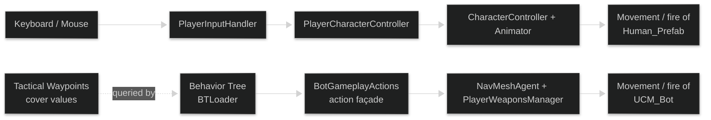
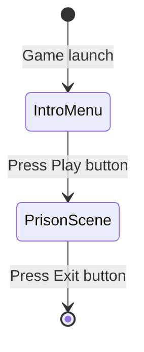
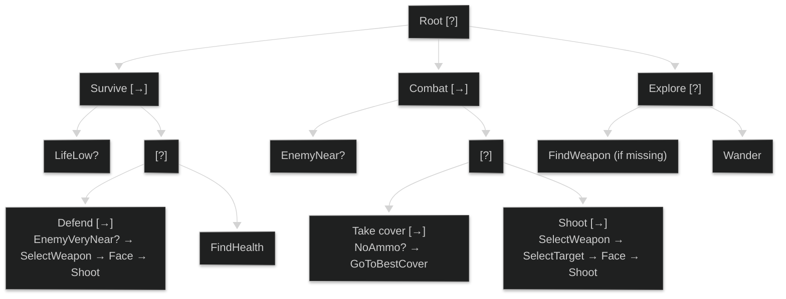

# IAV26 — Individual Final Project: Behavior Trees and Tactical Waypoints

**Author**
- Leopold Popper ([Kang-Hsi](https://github.com/Kang-Hsi))

# Summary

This is the individual final project for *Inteligencia Artificial para Videojuegos* at UCM. It extends the group practice **P3 — Disturbios Orbitales**, a 3D FPS prison scenario in which an intelligent agent (bot) competes against a human player in an infinite-respawn skirmish. P3 used a **Hierarchical Finite State Machine (HFSM)** as the bot's decision system, Unity NavMesh navigation driven by a singleton waypoint manager, and a kills / deaths / score HUD.

For this individual extension, the HFSM is **replaced** by a **Behavior Tree (BT)**, kept fully data-driven via ScriptableObjects in the same spirit as P3's HFSM. On top of that, the project's plain navigation waypoints are enriched into a **Tactical Waypoint** layer with a *cover-quality* score per point. A new BT leaf queries this layer during combat so the bot moves to good cover instead of standing in the open, with the goal of measurably improving the *Kills − Deaths* metric.

# Installation and usage

All project content is available in this repository. Unity 6 **(6000.3.12f1)** is used. The executable of the project is located in the repository so that the behaviors can be experienced.

# Introduction

The virtual environment is a 3D space prison populated by:

- **Prisoners** — mortal enemies of each other. Each can be controlled by a human player or a bot. They spawn at predefined respawn points and can move, shoot, aim, change weapons, jump, crouch, run, and fly with a jetpack.
- **Weapons** — collectible only by prisoners: pistol, missile launcher, sniper rifle, flamethrower, rifle, dual pistols, shotgun.
- **Utensils** — health kits and jetpack pickups.
- **Robotic guards** — patrol the prison and fire at any prisoner. Two kinds: stationary **turrets** (powerful but immobile) and **hover bots** (weaker but mobile).

The game is endless: a prisoner respawns each time it is eliminated. The bot's goal is to maximise *Kills − Deaths* over a session.

# Starting point

This repository was duplicated from the group practice [IAV26-G07-P3](https://github.com/IAV26-G07/IAV26-G07-P3) with its full commit history preserved for attribution. Individual work for this project begins at commit `Individual Project Start`. The group practice itself derives from the teacher's [FPS-Online](https://github.com/narratech/fps-online) starter, available on the Narratech [*Disturbios Orbitales*](https://narratech.com/es/inteligencia-artificial-para-videojuegos/decision/disturbios-orbitales/) page.

Architecturally, the human player and the bot share the same body (`CharacterController`, animations, weapons) and differ only in who decides their actions — input devices for the human, **Behavior Tree** for the bot:



# Project structure

The project root keeps the standard Unity layout. Most source code lives under `Assets/FPS/Scripts/`:

- `AI/` — bot perception, gameplay actions, weapons handling shared by player and bot.
- `Editor/` — editor-only utilities, including the tactical-waypoint baker.
- `Game/`, `Gameplay/` — gameplay and match scripts.
- `MiMultiplayer/` — multiplayer scaffolding and the HUD (`ClientScoreboardHUD`).
- `UI/` — UI screens.
- `PracticaIAV/` — the HFSM ScriptableObjects from P3 (kept for reference, unwired).
- `BT/` *(new)* — Behavior Tree runtime + ScriptableObject node definitions.
- `Tactical/` *(new)* — `TacticalWaypoint` type and the cover-quality baker.

# Problem statement

The project's scenes are: intro menu, win screen, lose screen, main scene, secondary scene, and the prison scene. The flow is simple — the player enters the prison scene from the menu and exits when they choose to:



The prototype delivers the following five characteristics.

# Characteristics

- **A — Adapted starting point.** P3's prison scenario reused as the environment: NavMesh, waypoints, respawn points, first-person and minimap cameras.

- **B — Player control.** The human player can move, jump, crouch, run, jetpack, aim, shoot, and switch weapons.

- **C — NavMesh navigation.** The bot uses Unity's NavMesh and the `WaypointsManager` to explore rooms, collect weapons and health packs, and pursue other prisoners.

- **D — Behavior Tree.** The bot's decision system is a Behavior Tree of `Task` nodes returning `run() -> bool`, composed with `Selector`, `Sequence`, and decorators, all data-driven via ScriptableObjects and instantiated by a `BTLoader`. It replaces P3's HFSM (kept in the codebase as historical context but unwired).

- **E — Tactical Waypoints (cover-point).** Plain navigation waypoints are enriched into a `TacticalWaypoint` carrying a `coverValue ∈ [0, 1]`, baked at editor time by the `getCoverQuality` ray-cast algorithm. A new BT leaf `GoToBestCover` picks the waypoint that maximises `coverValue × proximity` relative to the current enemy.

# Design

## Design decisions

- **BT over HFSM.** A BT encodes priority by node ordering inside the root `Selector` rather than by separately-defined transitions and levels. Every node is a `Task` returning `true` / `false`, which keeps the implementation small and the tree easy to extend.
- **Data-driven nodes.** Every BT node is a ScriptableObject, edited from the Unity inspector and instantiated at runtime by `BTLoader`. Designers can rewire the tree without recompiling.
- **Façade preserved.** The existing `BotGameplayActions` (`TryFireCurrentWeaponPrimary`, `TryPickHealth`, …) remains the only contract the BT calls into. The body of the bot is untouched.
- **Editor-time baking.** Cover values are computed once in editor (via menu item) using ray-casts, then serialised onto the asset. Runtime cost is zero: the BT only does a sort.
- **Tick from root.** Because `Task.run()` returns `bool` (no `RUNNING` state), the bot ticks the whole tree from the root every frame. This gives reactive behavior — the bot drops Combat for Survive the moment its life crosses the threshold.

## BT serialization

The BT graph is stored as `ScriptableObject` assets under `Assets/FPS/Scripts/BT/SO/`:

- **`TaskSO`** — abstract base. Holds editor metadata and a `Create()` factory that returns the runtime `Task` instance.
- **`CompositeTaskSO`** (extends `TaskSO`) — holds an ordered list of `children`. Subclassed by `SelectorSO` and `SequenceSO` (and optionally non-deterministic variants).
- **`DecoratorTaskSO`** (extends `TaskSO`) — wraps a single `child`. Subclassed for invert, until-failure, etc.
- **Leaf SOs** — concrete actions and conditions (`ShootSO`, `FaceSO`, `EnemyNearSO`, `LifeLowSO`, …). Many can be reused from P3's HFSM gameplay primitives.

`BTLoader.GetNode(TaskSO)` maps each SO to its runtime instance and caches it in a dictionary, so the same SO referenced from two places shares the same runtime node.

# Game controls

| Input | Function |
| -- | -- |
| Mouse | Camera rotation |
| Left mouse button | Fire the currently equipped weapon |
| Right mouse button | Zoom / aim down sights |
| Mouse wheel / number keys / E / Q | Switch weapons |
| Tab / P | Toggle options / pause menu |
| WASD / arrow keys | Move |
| C | Crouch |
| Space | Jump / jetpack |
| Shift | Sprint |

# Implementation

## Behavior Tree

### Tree structure

The bot's decision tree mirrors P3's HFSM priorities (Survive > Combat > Explore), expressed as a priority-ordered `Selector` at the root. Following the standard notation, `?` denotes a Selector and `→` denotes a Sequence:



The bot ticks the root every frame. A higher-priority subtree (Survive) preempts a lower one (Combat or Explore) as soon as its guard task returns `true`.

### Pseudocode

**1. Base task**

```py
class Task:
    # Return success (true) or failure (false).
    function run() -> bool
```

Every node in the behavior tree is a `Task`. Running the task returns either success or failure.

**2. Example leaf — condition**

```py
class EnemyNear extends Task:
    function run() -> bool:
        # Task fails if there is no enemy nearby.
        return distanceToEnemy < 10
```

**3. Example leaf — action**

```py
class PlayAnimation extends Task:
    animationId: int
    speed: float = 1.0
    function run() -> bool:
        if animationEngine.ready:
            animationEngine.play(animationId, speed)
            return true
        else:
            # Task fails: the animation could not be played.
            return false
```

**4. Selector**

```py
class Selector extends Task:
    children: Task[]
    function run() -> bool:
        for c in children:
            if c.run():
                return true
        return false
```

A selector tries each child in order. It succeeds as soon as one child succeeds.

**5. Sequence**

```py
class Sequence extends Task:
    children: Task[]
    function run() -> bool:
        for c in children:
            if not c.run():
                return false
        return true
```

A sequence tries each child in order. It fails as soon as one child fails. It only succeeds if all children succeed.

**6. Decorators**

Decorators wrap a single child task and modify how its result propagates. Common decorators include:

- limit the number of executions of a task,
- continue until a task returns failure,
- invert the returned value,
- act as a guard around a resource.

**7. Loader (singleton, mirrors `HFSMLoader`)**

```py
class BTLoader: (singleton)
    nodes: Dict[TaskSO, Task]

    function getNode(so) -> Task:
        if so not in nodes:
            nodes[so] = so.Create()
        return nodes[so]
```

## Tactical Waypoints

The plain `WaypointsManager` waypoints carry only a `Vector3` position. The new `TacticalWaypoint` extends this with a `coverValue ∈ [0, 1]` field, computed once at editor time by the cover-quality algorithm and stored on the asset.

### `getCoverQuality` pseudocode

From `iterations` candidate "enemy" positions around the location, rays are projected toward the location and the ratio of obstructed rays is returned.

```py
function getCoverQuality(location: Vector,
                         iterations: int,
                         characterSize: float) -> float:
    # Set the initial angle.
    theta = 0
    # Start with no hits.
    hits = 0
    # No valid rays yet.
    valid = 0
    for i in 0...iterations:
        # Create a point near the location.
        from = location
        from.x += RADIUS * cos(theta) + randomBinomial() * RAND_RADIUS
        from.y += random() * 2 * RAND_RADIUS
        from.z += RADIUS * sin(theta) + randomBinomial() * RAND_RADIUS
        # Check for a valid source point.
        # Example: do not allow the two points to be in the same room.
        if not sameRoom(from, location):
            valid += 1
            # Create the target point near the location.
            to = location
            to.x += randomBinomial() * characterSize.x
            to.y += random() * characterSize.y
            to.z += randomBinomial() * characterSize.z
            # Project a ray.
            if doesRayCollide(from, to):
                hits += 1
        # Update the angle.
        theta += ANGLE
    return float(hits) / float(valid)
```

A higher result means the position gives better cover.

### BT integration

A new BT leaf `GoToBestCover` is added to the Combat subtree, used when ammunition is low or a reload window is needed. It picks the waypoint that maximises a `coverValue × proximity` score relative to the current enemy:

```py
class GoToBestCover extends Task:
    function run() -> bool:
        target = currentEnemy()
        best = null
        bestScore = -infinity
        for wp in TacticalWaypointsManager.all():
            score = wp.coverValue / distance(bot, wp)   # cover × proximity
            if score > bestScore:
                bestScore = score
                best = wp
        if best == null: return false
        bot.NavigateTo(best.position)
        return true
```

# Tests and metrics

Test plan, organised by characteristic:

- **A**
  1. Verify weapons, utensils, and robotic guards spawn at their designated waypoints.
  2. Verify the first-person camera follows the protagonist.
  3. Verify the secondary minimap camera shows a top-down overview that updates as the agent moves.
- **B**
  1. Choose `Human_Prefab`. Verify it spawns at a predefined respawn point.
  2. Verify WASD movement, shooting, weapon switching, sprint, crouch, jump.
- **C**
  1. Choose `UCM_Bot`. Verify it explores the prison autonomously.
  2. Verify it avoids walls and obstacles and never gets stuck for long.
  3. Verify it walks to weapons and picks them up.
  4. Verify it detects and attacks other prisoners.
- **D**
  1. Verify the BT loads from ScriptableObjects without errors.
  2. Verify the bot switches behavior correctly: Explore → Combat on enemy near, Combat → Survive on low life.
  3. Verify `Selector`, `Sequence`, and decorator tasks return the expected `true` / `false` value (logged in the editor).
- **E**
  1. Verify the editor menu item bakes `coverValue` on every `TacticalWaypoint`.
  2. Visualise cover values as colour-coded gizmos in the scene view.
  3. Verify `GoToBestCover` routes the bot to a high-cover waypoint near the current enemy.
  4. Compare *Kills − Deaths* with and without the cover node enabled — expect a measurable improvement.

# Evolution

| Status | Task | Date |
| -- | -- | -- |
| ✔ | Individual Project Setup | 2026-05-18 |
| ☐ | BT runtime skeleton (`Task` base, `Selector`, `Sequence`, decorators) | — |
| ☐ | BT ScriptableObjects + `BTLoader` | — |
| ☐ | Rebuild Explore / Combat / Survive behavior in the BT | — |
| ☐ | Wire the bot to the BT, unwire the HFSM | — |
| ☐ | `TacticalWaypoint` type + editor-time `getCoverQuality` baker | — |
| ☐ | `GoToBestCover` + Combat subtree integration | — |
| ☐ | Final documentation pass, demo video, conclusions | — |

# Conclusions

*To be completed after implementation.*

# Demo video

*To be added after implementation.*

# License

- Educational and research use — UCM
- Copyright (c) 2026 Leopold Popper
- Permanent permission is granted to the professors of the Faculty of Informatics of the Complutense University of Madrid to use, reproduce, modify, or distribute, in whole or in part, this material (documentation, code, and resources), for educational or research purposes. Aggregated anonymous data may be extracted, and the material may be used with explicit attribution to the author.
- This license does not grant commercial use rights outside of the educational or research scope, except with explicit authorisation from the author.

# References

### Bibliography
- Millington, I. (2019). *AI for Games* (3rd ed.). CRC Press.
- Peinado, F. *Árbol de comportamiento* — lecture slides, UCM IAV26.
- Peinado, F. *Puntos de ruta tácticos* — lecture slides, UCM IAV26.
- Peinado, F. *Análisis táctico* — lecture slides, UCM IAV26.

### Starter resources
- Narratech: [*Disturbios Orbitales* — exercise statement](https://narratech.com/es/inteligencia-artificial-para-videojuegos/decision/disturbios-orbitales/)
- Narratech: [*FPS-Online* — starter project](https://github.com/narratech/fps-online)

### Reference video games
- Bungie (2001). *Halo: Combat Evolved* — Behavior Tree-based enemy AI.
- Crytek (2007). *Crysis* — tactical cover use in open-combat AI.
